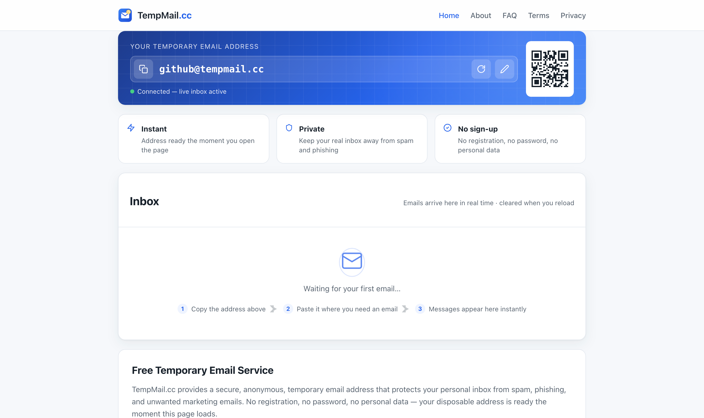

# Tempmail

English | [中文](README.zh-CN.md)

Temporary email service with live inbox over WebSocket. Full rewrite of
forsaken-mail (2015-era Node.js) with a modern, dependency-clean stack.

<p align="center">
  
</p>

## Demo

The production instance is live at **[tempmail.cc](https://tempmail.cc/)** —
open it and a disposable inbox is ready instantly, no sign-up.

## Architecture

```
src/
├── server.js            entry point: http + express + socket.io + smtp
├── config.js            env-driven configuration
├── lib/id.js            mailbox name generation & validation (allowlist)
├── smtp/gateway.js      inbound SMTP (smtp-server + mailparser)
├── realtime/inbox.js    socket.io layer, mailbox -> sockets registry
└── web/app.js           express static hosting + healthz
public/                  frontend (vanilla JS, unchanged wire protocol)
scripts/e2e.mjs          end-to-end delivery test
```

## Run

```bash
npm install
npm start                     # web on :3000, smtp on :25
PORT=8080 SMTP_PORT=2525 npm start   # dev-friendly ports
```

## Environment variables

| Variable            | Default | Description                     |
|---------------------|---------|---------------------------------|
| `PORT`              | 3000    | web port                        |
| `HOST`              | 0.0.0.0 | web bind address                |
| `SMTP_PORT`         | 25      | inbound SMTP port               |
| `SMTP_HOST`         | 0.0.0.0 | SMTP bind address               |
| `SMTP_MAX_MAIL_BYTES` | 5242880 | max accepted message size    |
| `SMTP_RATE_PER_MIN` | 20      | per-mailbox live-broadcast rate limit |
| `ANALYTICS_DISABLED` | (unset) | set to `1` to drop Google Analytics origins from the CSP |
| `ANALYTICS_CSP_EXTRA` | (unset) | space-separated origins to whitelist for your own analytics provider (script-src + connect-src) |

## Test

```bash
PORT=3100 SMTP_PORT=2525 npm start &   # in one terminal
node scripts/e2e.mjs                   # in another
```

## Analytics

All page tracking lives in a single file: `public/js/ga.js` (Google Analytics 4,
IP anonymized). Self-hosting? Replace it with your own tracking code or blank it
out — no HTML edits needed.

The server CSP only whitelists Google's analytics origins by default. To use a
different provider:

1. Replace `public/js/ga.js` with your provider's snippet.
2. Whitelist its origins via `ANALYTICS_CSP_EXTRA`, e.g.:
   - **Plausible**: `ANALYTICS_CSP_EXTRA=https://plausible.io`
   - **Umami** (self-hosted): `ANALYTICS_CSP_EXTRA=https://umami.example.com`
   - **Matomo** (self-hosted): `ANALYTICS_CSP_EXTRA=https://matomo.example.com`
   - **Cloudflare Web Analytics**: `ANALYTICS_CSP_EXTRA=https://static.cloudflareinsights.com https://cloudflareinsights.com`
3. Using none at all? Set `ANALYTICS_DISABLED=1` to strip the Google origins
   from the CSP too.

## Deployment notes

- Port 25 must be reachable directly (MX record → this host). No CDN/proxy for mail; web may sit behind Cloudflare/nginx.
- Inherent design caveat (unchanged from the original): anyone may `set shortid`
  to any valid name and receive that mailbox's live mail. That is the product.
- Abuse guards: per-mailbox broadcast rate limiting (`SMTP_RATE_PER_MIN`), security
  headers (CSP, X-Frame-Options) on the web app, and graceful SMTP shutdown on restart.

## Docker deployment (from git clone to running)

Requires: a server (Ubuntu shown) with Docker installed (`curl -fsSL https://get.docker.com | sh`),
DNS: A record of your mail domain → server IP, MX record → that domain.

```bash
# 1. clone & build
git clone <repo-url> /var/www/tempmail
cd /var/www/tempmail
docker build -t tempmail .

# 2. run (restarts on reboot/crash)
docker run -d --name tempmail \
  -p 3000:3000 \
  -p 25:25 \
  --restart unless-stopped \
  tempmail

# 3. verify
curl localhost:3000/healthz      # {"ok":true}
docker logs -f tempmail          # structured logs; SMTP should log "listening on 0.0.0.0:25"
```

### Fronting the web UI with nginx (optional, mail stays direct)

Only web traffic goes through nginx; SMTP :25 must point straight at the host.

```nginx
map $http_upgrade $connection_upgrade {
    default upgrade;
    ''      close;
}

server {
    listen 443 ssl http2;
    server_name your.domain;

    ssl_certificate     /etc/letsencrypt/live/your.domain/fullchain.pem;   # certbot
    ssl_certificate_key /etc/letsencrypt/live/your.domain/privkey.pem;

    location / {
        proxy_pass http://127.0.0.1:3000;
        proxy_http_version 1.1;
        proxy_set_header Host $host;
        proxy_set_header X-Real-IP $remote_addr;
        proxy_set_header X-Forwarded-For $proxy_add_x_forwarded_for;
        proxy_set_header X-Forwarded-Proto $scheme;
        # WebSocket — required for the live inbox
        proxy_set_header Upgrade $http_upgrade;
        proxy_set_header Connection $connection_upgrade;
        proxy_read_timeout 86400;
    }
}
```

```bash
ln -sf /etc/nginx/sites-available/your.domain /etc/nginx/sites-enabled/your.domain
nginx -t && systemctl reload nginx
```

Behind Cloudflare: leave proxying on for web (A record orange-cloud); WebSocket
must be enabled (Network settings). DNS-only (grey cloud) the record if you serve
mail UI elsewhere — MX record itself must never point at a proxy.

### Updating

```bash
git pull
docker rm -f tempmail
docker build -t tempmail .
docker run -d --name tempmail -p 3000:3000 -p 25:25 --restart unless-stopped tempmail
```

### Troubleshooting

| Symptom | Check |
|---------|-------|
| `port 25 already allocated` on `docker run` | old container still bound: `docker ps -a \| grep 25`, then `docker rm -f <name>` |
| Site 404 through the whole stack | verify origin directly: `curl -sI http://127.0.0.1:3000/` — if 404 there, rebuild the image from latest code |
| Page loads but inbox stuck "Connecting…" | WS handshake: `curl -s "https://your.domain/socket.io/?EIO=4&transport=polling"` must return `0{"sid":...}`; if it does, hard-refresh — browser/CF is serving stale frontend JS |
| Mail accepted in logs but never shown | recipient local part must match the claimed mailbox name; check `[smtp] accepted mail` lines in `docker logs` |
| `nginx recv() failed (104)` spikes | container restarting — `docker ps` for restart loop, then `docker logs tempmail` |
